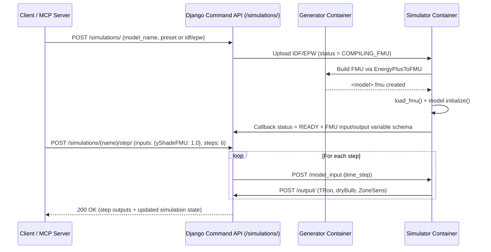

# Future Work: Simulation Command API & MCP Server

This document outlines the planned architecture for a high-level **Simulation Command API** and a companion **Model Context Protocol (MCP) Server** (`simapi_mcp`) to enable programmatic orchestration and AI-in-the-loop building energy control.

---

## 1. Motivation and Current Limitations

The current `simapi_web` service exposes low-level CRUD and GraphQL endpoints (`/user/`, `/login/`, `/init_model/`, `/input/`, `/output/`, `/graphql/`), which place orchestration responsibilities on client scripts:

1. **No explicit lifecycle state machine**: `POST /init_model/` returns `201 Created` immediately while `web_worker`, `generator`, and `simulator` compile the `.fmu` and run `fmiInitializeSlave` asynchronously (~20–30 seconds). Clients currently have no API endpoint to query whether a model is `COMPILING_FMU`, `INITIALIZING`, `READY`, `RUNNING`, `COMPLETED`, or `FAILED`.
2. **No FMU variable schema introspection**: `SimulationObject` discovers `model_output_vars`, `model_real_vars`, and `model_int_vars` inside the simulator container when loading the FMU, but does not report this metadata back to `simapi_web`. Callers must know variable names (such as `yShadeFMU`, `TRoo`, `dryBulb`, `ZoneSens`) ahead of time.
3. **Two-phase stepping**: Advancing a single time step requires posting to `POST /input/` and then polling `POST /graphql/` until the corresponding `Output` record is written by the simulator worker.
4. **Single-run simulator lifecycle**: `simulation_process.py` keeps `model_params_set = True` and `prev_time_step` in memory until `final_time` is reached (`free_instance()`). There is no API command to abort, reset, or re-initialize a simulator instance early without restarting the container.

---

## 2. Proposed Simulation Command API (`simapi_web`)

All existing endpoints (`/user/`, `/login/`, `/init_model/`, `/input/`, `/output/`, `/graphql/`) remain unchanged for backward compatibility, while a new `/simulations/` command surface manages the full co-simulation lifecycle.

### Planned Endpoints

| Method & Path | Purpose | Planned Behavior |
| :--- | :--- | :--- |
| `POST /simulations/` | **Initialize simulation** | Accepts `model_name`, `step_size`, `final_time`, and either uploaded `idf_file`/`epw_file` or `"preset": "default"` (using bundled `test_setup_files/update.idf` and `update.epw`). Tracks lifecycle `status` (`INITIALIZING` -> `READY` -> `RUNNING` -> `COMPLETED` / `FAILED`). |
| `GET /simulations/` | **List simulations** | Returns all models with their `status`, `current_time_step`, `step_size`, `final_time`, and discovered `input_vars` / `output_vars`. |
| `GET /simulations/<name>/` | **Inspect state & schema** | Returns current lifecycle state, FMU variable metadata (`real_vars`, `int_vars`, `output_vars`), and the latest time-step input/output. |
| `POST /simulations/<name>/step/` | **Synchronous step / horizon** | Accepts `{"inputs": {"yShadeFMU": 0.5}, "steps": 1, "timeout": 60}`. Automatically determines the next `time_step`, dispatches the step(s) to the simulator, waits for the output(s), and returns the step result(s) in a single HTTP response. |
| `POST /simulations/<name>/run/` | **Batch / schedule run** | Accepts a `duration` and either constant `inputs` or a time-step schedule (`{"0": {"yShadeFMU": 1.0}, "3600": {"yShadeFMU": 0.0}}`), executes the run, and returns the trajectory and summary KPIs. |
| `GET /simulations/<name>/timeseries/` | **Trajectory & KPIs** | Returns aligned `[{time_step, inputs, outputs}, ...]` plus computed metrics (min/max/mean `TRoo`, min/max `dryBulb`, mean/peak `ZoneSens`, and integrated thermal energy in kWh). |
| `POST /simulations/<name>/reset/` | **Stop / free FMU** | Calls a `/reset` endpoint on `sim_api.py` to invoke `free_instance()` and reset `MyHandler` state so the simulator container can initialize a new model without restarting Docker. |

---

## 3. Proposed MCP Server (`simapi_mcp`)

A standalone Python MCP server built with `FastMCP` (supporting `stdio` for local IDEs/desktop agents and `streamable-http` for remote agents) will wrap the Simulation Command API so AI agents can inspect, control, and evaluate EnergyPlus building simulations interactively.

### A. MCP Tools

1. **`simapi_status`**
   - Checks stack health, database/broker connectivity, simulator availability, and active simulations.
2. **`simapi_init_model`**
   - **Arguments**: `model_name: str`, `step_size: int = 600`, `final_time: float = 24.0`, `idf_path: str | None = None`, `epw_path: str | None = None`, `wait_ready: bool = True`
   - **Behavior**: Starts FMU compilation and EnergyPlus initialization (defaulting to the bundled IDF/EPW files when paths are omitted), waits until `status == "READY"`, and returns the FMU's controllable input variables and observable output variables.
3. **`simapi_step`**
   - **Arguments**: `model_name: str`, `inputs: dict[str, float | int]`, `steps: int = 1`
   - **Behavior**: Advances the simulation by `steps` time steps (e.g., `steps=6` for 1 hour at `600s` steps) with the given control signals (e.g., `{"yShadeFMU": 0.0}`) and returns the resulting `time_step`, `TRoo`, `dryBulb`, and `ZoneSens`.
   - **Use case**: Enables closed-loop agent control where an LLM or controller observes outdoor temperature (`dryBulb`), zone temperature (`TRoo`), and sensible load (`ZoneSens`) at each interval and dynamically adjusts `yShadeFMU` or HVAC setpoints.
4. **`simapi_run_experiment`**
   - **Arguments**: `model_name: str`, `duration: int = 86400`, `default_inputs: dict`, `schedule: dict[int, dict] | None = None`
   - **Behavior**: Executes a multi-hour or full-day simulation in a single tool call and returns summary statistics and the sampled trajectory.
5. **`simapi_get_summary_and_timeseries`**
   - **Arguments**: `model_name: str`, `start_time: int = 0`, `end_time: int | None = None`
   - **Behavior**: Returns comfort and energy KPIs (integrated heating/cooling Wh, peak W, indoor temperature bounds) alongside the time-series records.
6. **`simapi_reset_simulator`**
   - **Arguments**: `model_name: str`
   - **Behavior**: Frees the active FMU slave instance and resets the simulator container state for subsequent runs.

### B. MCP Resources

- `simapi://simulations` — JSON list of all initialized models and their lifecycle statuses.
- `simapi://simulations/{model_name}/schema` — Discovered FMU input/output variable names, units, step size, and simulation horizon.
- `simapi://simulations/{model_name}/timeseries` — Full JSON time series of inputs and outputs for a model.

### C. MCP Prompts

- `optimize_shading_control` — Guides an agent through initializing a building model, stepping through a 24-hour horizon while adjusting `yShadeFMU` based on outdoor `dryBulb` and indoor `TRoo` to minimize `ZoneSens` sensible load, and comparing total energy demand against a static baseline (`yShadeFMU = 1.0`).

---

## 4. Implementation Roadmap

1. **Extend `FmuModel` in `simapi_web`**:
   - Add `status`, `error_message`, `current_time_step`, `input_vars`, and `output_vars` fields to `rest_api.models.FmuModel`.
2. **Add Simulator Readiness & Reset Hooks**:
   - Have `simulation_process.py` post discovered FMU variable names (`model_real_vars`, `model_int_vars`, `model_output_vars`) and `status="READY"` back to `simapi_web` immediately after `self.sim_obj.model_init()` completes.
   - Add `POST /reset` in `simulator_api/sim_api.py` to terminate and free an active FMU slave cleanly.
3. **Implement `/simulations/` Command ViewSet**:
   - Provide synchronous `/step/`, batch `/run/`, `/timeseries/` KPI aggregation, and `/reset/` endpoints in `simapi_web`.
4. **Package `simapi_mcp`**:
   - Implement the `FastMCP` server in `src/simapi_mcp/` with unit tests and an example MCP client configuration (`claude_desktop_config.json` / `.mcp.json`).
